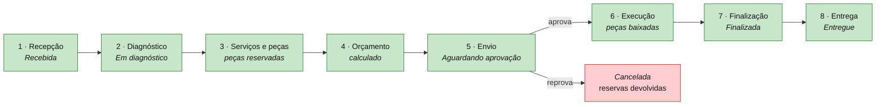
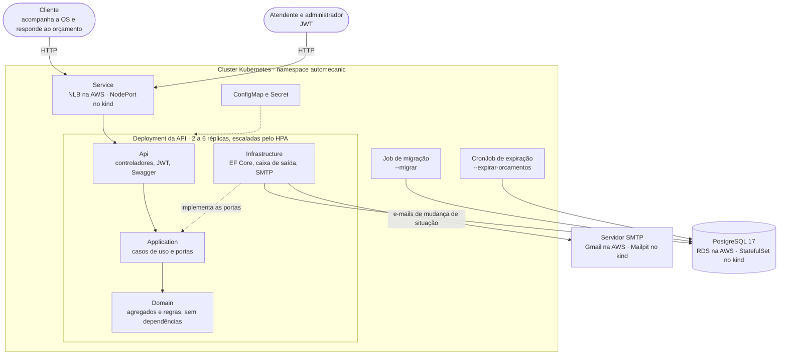
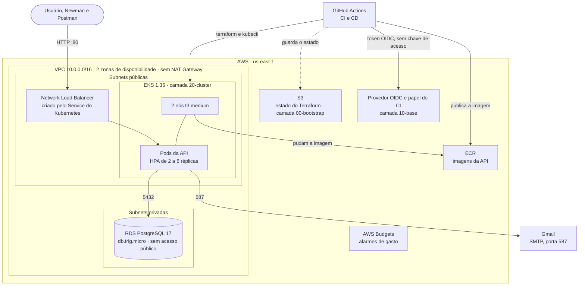
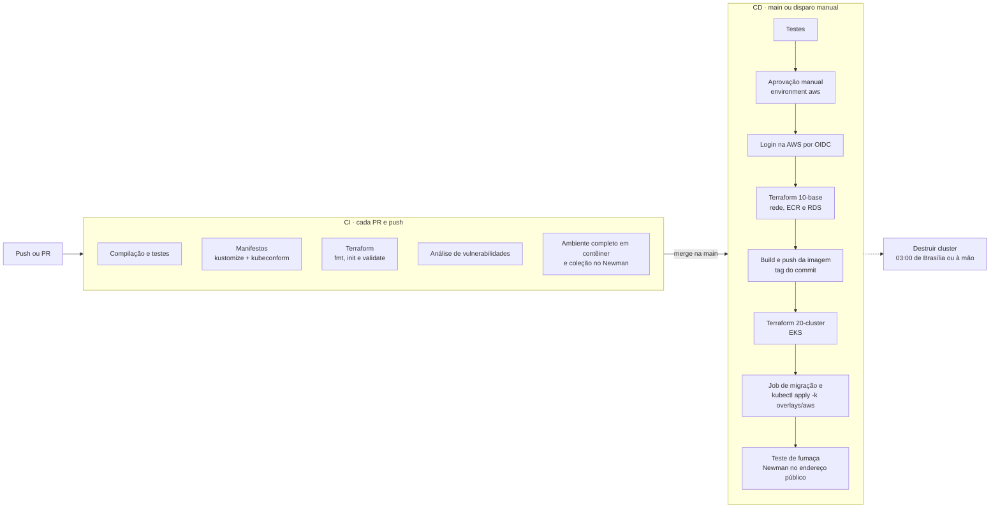

# AutoMecanic

**Sistema Integrado de Atendimento e Execução de Serviços** — back-end de gestão para uma
oficina mecânica de médio porte.

> Tech Challenge · Fase 2 — Pós-Tech FIAP, turma 15SOAT

[](https://dotnet.microsoft.com/)
[](https://www.postgresql.org/)
[]()
[]()
[]()

---

## Fase 2 em resumo

Na Fase 1 a oficina ganhou um sistema de gestão que rodava em um único `docker compose`. Com a
expansão para novas unidades e os picos de demanda, a Fase 2 leva a mesma aplicação para um
ambiente **escalável, automatizado e reproduzível**:

| Objetivo da fase | O que foi entregue | Onde |
|---|---|---|
| Reduzir riscos operacionais com infraestrutura escalável | Kubernetes (EKS na AWS e kind localmente): 2 a 6 réplicas sob HPA por CPU e memória, sondas de saúde e PodDisruptionBudget | [`k8s/`](k8s/) |
| Automatizar o provisionamento e o deploy | Terraform em três camadas (estado, base e cluster) e pipeline de CD no GitHub Actions, sem chave de acesso guardada (OIDC) | [`infra/`](infra/) · [`.github/workflows/`](.github/workflows/) |
| Melhorar a qualidade e a organização do código | Clean Architecture, com a regra de dependência verificada por testes de arquitetura, e 598 testes automatizados | [`src/`](src/) · [`tests/`](tests/) |
| Suportar picos de ordens de serviço | Escalabilidade dinâmica pelo HPA, migração como Job, e-mails por caixa de saída (*outbox*) que sobrevive à remoção de réplicas e limites de taxa | [`k8s/base`](k8s/base/) · [ADRs](docs/05-arquitetura.md) |

**APIs da fase**

| Requisito | Endpoint |
|---|---|
| Abertura de OS (cliente, veículo, serviços e peças), devolvendo a identificação única | `POST /api/v1/ordens-servico/recepcao` |
| Consulta de status da OS | `GET /api/v1/ordens-servico/{id}/status` · `GET /api/v1/acompanhamento` (cliente) |
| Aprovação ou recusa do orçamento pelo cliente | `POST /api/v1/acompanhamento/orcamento/aprovar` · `/reprovar` |
| Listagem priorizada (Em execução > Aguardando aprovação > Em diagnóstico > Recebida; mais antigas primeiro; encerradas fora da fila, sem apagar nada) | `GET /api/v1/ordens-servico` |
| Atualização de status por e-mail | O cliente recebe um e-mail a cada mudança de situação da OS ([detalhes](#e-mails-ao-cliente)) |

**Links**

| Item | Onde |
|---|---|
| Repositório | https://github.com/IgorSalvador/AutoMecanic |
| **Collection das APIs (Postman)** | [`postman/`](postman/README.md): 124 requisições, todos os 76 endpoints, com verificações automáticas |
| Documentação interativa (Swagger) | `/swagger` em qualquer ambiente (local: http://localhost:8080/swagger) |
| **Vídeo demonstrativo** (até 15 min) | 🎬 **A PREENCHER:** colar aqui o link do YouTube/Vimeo depois da gravação |

---

## O problema

A oficina controlava atendimento, diagnóstico, execução e entrega em **anotações manuais e
planilhas**. O resultado eram cinco problemas concretos, e o sistema responde a cada um deles:

| Problema relatado | Como o sistema resolve |
|---|---|
| Erros na priorização dos atendimentos | Máquina de estados explícita da OS + painel operacional por situação |
| Falhas no controle de peças e insumos | Saldo decomposto em **físico / reservado / disponível**, com razão *append-only* |
| Dificuldade em acompanhar o status dos serviços | Status muda automaticamente por ação, com linha do tempo e consulta pública para o cliente |
| Perda de histórico de clientes e veículos | Cadastros são **inativados, nunca excluídos**; toda OS permanece rastreável |
| Ineficiência no fluxo de orçamentos e autorizações | Orçamento **calculado automaticamente**, com validade, aprovação e reprovação registradas |

---

## Execução local (Docker Compose)

A forma mais simples de rodar tudo na própria máquina. Para o cluster Kubernetes local, veja
[Deploy em Kubernetes](#deploy-em-kubernetes); para a nuvem, [Provisionamento com Terraform](#provisionamento-com-terraform).

**Pré-requisito único:** Docker com Compose. Nada mais precisa estar instalado.

```bash
git clone <url-do-repositorio> && cd AutoMecanic
cp .env.example .env
```

Edite o `.env` — os três valores marcados precisam ser trocados:

```bash
POSTGRES_PASSWORD=<uma senha forte>
JWT_CHAVE=<32+ caracteres; gere com: openssl rand -base64 48>
SEED_SENHA_ADMIN=<senha do admin: 8+ caracteres, maiúscula, minúscula, dígito e símbolo>
```

Suba tudo:

```bash
docker compose up -d --build
```

Pronto. O banco é criado, as migrações são aplicadas e a carga inicial é semeada
automaticamente.

| Recurso | Endereço |
|---|---|
| **Documentação interativa (Swagger)** | http://localhost:8080/swagger |
| Prontidão (verifica o banco) | http://localhost:8080/health/pronto |
| Vivacidade (só o processo) | http://localhost:8080/health/vivo |
| **Caixa de entrada dos e-mails (Mailpit)** | http://localhost:8025 |

O compose sobe também o [Mailpit](https://mailpit.axllent.org), um servidor SMTP de
desenvolvimento: os e-mails de mudança de situação da OS chegam nele e não saem para ninguém.
Para enviar de verdade (Gmail, por exemplo), ajuste as variáveis `SMTP_*` do `.env`.

### Primeiro acesso

```bash
curl -X POST http://localhost:8080/api/v1/autenticacao/login \
  -H "Content-Type: application/json" \
  -d '{"email":"admin@automecanic.com.br","senha":"<SEED_SENHA_ADMIN>"}'
```

Copie o `token` da resposta e informe-o no botão **Authorize** do Swagger.

Com `SEED_DEMO=true` (padrão), o ambiente já vem povoado: **10 serviços**, **12 peças**,
**8 clientes com veículos** e **8 Ordens de Serviço distribuídas por todas as situações** —
3 entregues, 1 em execução, 1 aguardando aprovação, 1 cancelada, 1 em diagnóstico e 1 recebida.

Isso significa que o **painel operacional**, o **indicador de tempo médio de execução** e os
**alertas de estoque** já respondem com dados reais no primeiro acesso, sem precisar executar
o fluxo à mão antes de ver qualquer número.

### Encerrando

```bash
docker compose down       # para os contêineres, preserva os dados
docker compose down -v    # remove também o volume do banco
```

---

## Experimentando o fluxo completo

Os oito passos abaixo percorrem o ciclo de vida inteiro de uma Ordem de Serviço. Todos estão
prontos para executar no Swagger.



**1 · Recepção** — identifica o cliente pelo CPF/CNPJ, localiza ou cadastra o veículo pela
placa, abre a OS e, se informados, já inclui os serviços e reserva as peças, tudo em uma
chamada. A resposta `201` traz o `id` e o `numero` da OS. Faltando saldo de uma peça, nada
é gravado:

```http
POST /api/v1/ordens-servico/recepcao
{
  "documentoCliente": "111.444.777-35",
  "nomeCliente": "Carlos Andrade",
  "emailCliente": "carlos@exemplo.com.br",
  "telefoneCliente": "(11) 91234-5678",
  "placa": "JKL5M67",
  "marca": "Toyota", "modelo": "Corolla",
  "anoFabricacao": 2021, "anoModelo": 2022,
  "descricaoProblema": "Ruído metálico ao frear em baixa velocidade.",
  "quilometragemEntrada": 42000,
  "servicos": [{ "servicoId": "<id do serviço>", "quantidade": 1 }],
  "pecas":    [{ "pecaId": "<id da peça>", "quantidade": 2 }]
}
```

**2 ·** `POST /api/v1/ordens-servico/{id}/diagnostico/iniciar`, depois
`POST .../diagnostico` com o laudo.

**3 ·** `POST .../servicos` e `POST .../pecas` — **a peça é reservada no estoque na mesma
transação**. Consulte `GET /api/v1/pecas/{id}` e veja o disponível cair sem o saldo físico mudar.

**4 ·** `POST .../orcamento` com `{"percentualDesconto": 10}` — o valor é calculado, nunca informado.

**5 ·** `POST .../orcamento/enviar`. **A partir daqui os itens ficam congelados** — tente
adicionar um serviço e receba `422`.

**6 ·** `POST .../orcamento/aprovar` → a OS vai para *Em execução* e as peças são **baixadas
do estoque**. Ou `POST .../orcamento/reprovar` → a OS é cancelada e as **reservas voltam**.

**7 ·** `POST .../finalizar` — a duração real passa a alimentar o indicador de tempo médio.

**8 ·** `POST .../entregar` — estado terminal. Qualquer nova ação recebe `422`.

Todas as requisições acima estão prontas em duas formas:

- **[Coleção Postman](postman/)** — 124 requisições cobrindo os 76 endpoints, com dois fluxos
  guiados e 96 verificações automáticas. Importe os dois arquivos de `postman/` e execute as
  pastas *00 · Fluxo completo* e *00 · Fase 2*.
- **[`AutoMecanic.http`](AutoMecanic.http)** — para quem prefere não sair do editor, com a
  extensão *REST Client* do VS Code.

**Fila de trabalho** — `GET /api/v1/ordens-servico` lista as OS por prioridade de atendimento
(*Em execução* > *Aguardando aprovação* > *Em diagnóstico* > *Recebida*), das mais antigas para
as mais novas dentro de cada situação. Finalizadas, entregues e canceladas saem da fila — nada é
apagado — e voltam com `incluirEncerradas=true` ou pedindo a situação em `status`.

**Autoatendimento do cliente**, sem autenticação — acompanhar a OS e responder ao orçamento
recebido, sempre com o número da OS e o CPF/CNPJ do titular:

```http
GET  /api/v1/acompanhamento?numero=OS-2026-000001&documento=11144477735

POST /api/v1/acompanhamento/orcamento/aprovar
{ "numero": "OS-2026-000001", "documento": "11144477735" }

POST /api/v1/acompanhamento/orcamento/reprovar
{ "numero": "OS-2026-000001", "documento": "11144477735", "motivo": "Vou pensar." }
```

A aprovação tem o mesmo efeito da registrada pelo atendente: a OS entra em execução e as
peças são baixadas. Documento que não confere recebe a mesma resposta de OS inexistente.

---

## Documentação

| Documento | Conteúdo |
|---|---|
| [Visão geral](docs/00-visao-geral.md) | Índice e mapa de leitura |
| [Linguagem Ubíqua](docs/01-linguagem-ubiqua.md) | Vocabulário do negócio e sua tradução para o código |
| [Event Storming](docs/02-event-storming.md) | Os quatro fluxos completos, com comandos, eventos, políticas e hotspots |
| [Context Map](docs/03-context-map.md) | Contextos delimitados e a natureza de cada relacionamento |
| [Modelo de Domínio](docs/04-modelo-de-dominio.md) | Agregados, entidades, objetos de valor e invariantes |
| [Arquitetura](docs/05-arquitetura.md) | Camadas e as decisões técnicas, com seus custos |
| [Relatório de segurança](docs/06-relatorio-de-seguranca.md) | Análise de vulnerabilidades e OWASP API Top 10 |
| [Guia de testes](docs/07-guia-de-testes.md) | Como testar tudo: testes automatizados, compose, Kubernetes local, HPA e roteiro da AWS |
| [AWS do zero](docs/08-guia-aws-do-zero.md) | Passo a passo para quem nunca usou nuvem: conta, MFA, alarmes de custo, usuários, CLI e Terraform |
| [Deploy na AWS (CI/CD)](docs/09-guia-cd-aws.md) | Configurar o GitHub e a AWS, rodar o deploy e, em cada etapa, como desligar para não gerar custo |
| [Plano da Fase 2](docs/fase2/plano-de-implementacao.md) | Decisões, tarefas e situação da evolução para Kubernetes, Terraform e CI/CD |
| [Documento de entrega](docs/ENTREGA.md) | Modelo para exportação em PDF |
| [Coleção Postman](postman/README.md) | Como importar, executar e regerar a coleção |

---

## Arquitetura da solução

Três visões da mesma solução: os componentes da aplicação, a infraestrutura provisionada na AWS
e o caminho do código até o cluster.

### Componentes da aplicação

A imagem Docker é única e tem três modos de execução: a **API** (que também roda o envio de
e-mails em segundo plano), o **Job de migração** (`--migrar`) e o **CronJob** que expira orçamentos
vencidos (`--expirar-orcamentos`). Todos usam o mesmo PostgreSQL.



### Infraestrutura provisionada na AWS

Criada pelo Terraform (três camadas) e pelo Kubernetes (o balanceador). Tudo em `us-east-1`.



| Camada do Terraform | Recursos | Muda com frequência? |
|---|---|---|
| `infra/00-bootstrap` | Bucket S3 do estado (versionado, criptografado, sem acesso público) | Nunca |
| `infra/10-base` | VPC, ECR, RDS, provedor OIDC e papel do CI, alarmes de gasto | Raramente (fica de pé) |
| `infra/20-cluster` | EKS, grupo de nós, add-ons e acessos | **Criada e destruída sob demanda** |

### Fluxo de deploy

O CI valida cada PR; o CD só roda na `main` (ou à mão), depois de uma **aprovação manual**. Um
workflow agendado destrói o cluster toda madrugada para não gerar custo.



---

## Arquitetura da aplicação (camadas)

Monolito em camadas, com a **regra de dependência apontando para dentro**:

```
📡 Api             controladores, middlewares, Swagger, JWT
        ↓
⚙️  Application     casos de uso, DTOs, validadores, portas
        ↓
💎 Domain          agregados, objetos de valor, eventos      ← zero dependências
        ↑
🔌 Infrastructure  EF Core, PostgreSQL, BCrypt, JWT           ← implementa as portas
```

O **Domínio não tem um único pacote NuGet**. Suas 439 verificações rodam em 3 segundos, sem
banco e sem configuração.

### Escolhas técnicas

| Decisão | Justificativa resumida |
|---|---|
| **PostgreSQL 17** | Licença livre; `xmin` nativo para concorrência otimista; `INSERT … ON CONFLICT … RETURNING` para numeração atômica; imagem de 90 MB. [Detalhamento](docs/05-arquitetura.md#adr-01--postgresql-como-banco-de-dados) |
| **Um caso de uso por classe**, sem mediador | Cada operação da OS é uma classe coesa e testável isoladamente; chamada direta, sem MediatR, porque um *pipeline* de *behaviors* não resolveria problema real |
| **Reserva de estoque** | Baixar na inclusão sumiria com peça de orçamento reprovado; baixar só na aprovação deixaria duas OS venderem a mesma peça |
| **Eventos antes do commit** | Torna atômico o par saldo + lançamento no razão |
| **Testcontainers** | Conversores de VO, `CHECK`, `xmin` e `ILIKE` não existem fora do PostgreSQL |
| **Imagem *chiseled*** | 8 pacotes de SO em vez de ~90; sem shell nem gerenciador de pacotes |

---

## Testes e qualidade

```bash
dotnet test                                             # 598 verificações
dotnet test tests/AutoMecanic.UnitTests                 # 475, ~3 s, sem I/O
dotnet test tests/AutoMecanic.ArchitectureTests         # 22, regras de dependência entre camadas
dotnet test tests/AutoMecanic.IntegrationTests          # 101, PostgreSQL real (exige Docker)
```

Relatório de cobertura:

```bash
dotnet test --collect:"XPlat Code Coverage" --settings coverlet.runsettings --results-directory TestResults
dotnet tool restore
dotnet reportgenerator -reports:"TestResults/*/coverage.cobertura.xml" -targetdir:coverage -reporttypes:Html
```

| Camada | Cobertura de linhas |
|---|---:|
| **Application** | **97,1%** |
| **Domain** | **90,9%** |
| Api | 89,6% |
| Infrastructure | 88,4% |
| **Total** | **92,2%** |

Os testes de integração sobem um **PostgreSQL real** via Testcontainers e exercitam a API
completa — autenticação, autorização por perfil, o fluxo inteiro da OS e a coordenação com o
estoque. Foram eles que encontraram os três defeitos descritos no
[relatório de segurança](docs/06-relatorio-de-seguranca.md#6-defeitos-encontrados-e-corrigidos-durante-o-desenvolvimento).

---

## Segurança

| Controle | Implementação |
|---|---|
| Autenticação | JWT HMAC-SHA256, validade de 60 min, sem tolerância de relógio |
| Senhas | BCrypt com fator de custo 12, salt por hash |
| Força bruta | Bloqueio de 15 min após 5 tentativas; limite de 10 logins/min por origem |
| Enumeração de contas | Resposta idêntica para e-mail inexistente e senha errada |
| Autorização | Políticas por capacidade de negócio, não por cargo |
| Dados sensíveis | CPF/CNPJ e placa validados por dígito verificador e formato |
| Exposição de dados | Nenhum agregado é serializado; toda resposta passa por DTO |
| Consumo de recursos | Limite de taxa global e página máxima de 100 itens |
| Contêiner | Imagem *chiseled*, usuário sem privilégios, `no-new-privileges` |

**Resultado da varredura:** 0 vulnerabilidades críticas ou altas; 0 no código e nas
dependências .NET. [Relatório completo](docs/06-relatorio-de-seguranca.md).

---

## Deploy em Kubernetes

Os manifestos usam [Kustomize](https://kustomize.io): um `base` comum e um *overlay* por
ambiente, de modo que o cluster local e o da AWS rodam os mesmos recursos.

```
k8s/
├── base/               recursos comuns a qualquer cluster
└── overlays/
    ├── local/          kind: PostgreSQL, Mailpit e metrics-server dentro do cluster
    │   └── carga/      teste de carga (k6) para demonstrar o HPA
    └── aws/            EKS: imagem do ECR, banco no RDS, e-mail pelo Gmail, entrada por NLB
```

| Recurso (`k8s/base`) | Detalhes |
|---|---|
| **Deployment** | 2 réplicas no mínimo; *requests* e *limits*; sondas de inicialização, vivacidade (`/health/vivo`) e prontidão (`/health/pronto`); `runAsNonRoot`, sem escalonamento de privilégio e sem *capabilities* |
| **Service** | `ClusterIP` no base; `NodePort` no kind; `LoadBalancer` (NLB) na AWS |
| **ConfigMap e Secret** | Configuração em variáveis de ambiente. Valores sensíveis (cadeia do banco, chave JWT, senha do admin, credenciais SMTP) ficam no **Secret**, criado fora do git; `secret.modelo.yaml` documenta as chaves |
| **HPA** | `autoscaling/v2`, alvo de 70% de CPU e 80% de memória, de 2 a 6 réplicas |
| **PodDisruptionBudget** | Mantém pelo menos uma réplica durante manutenções dos nós |
| **Job de migração** | Aplica as migrações e a carga inicial antes de a API subir (várias réplicas não migram ao mesmo tempo) |
| **CronJob** | Expira os orçamentos vencidos e devolve as reservas de peça ao estoque |

### Em um cluster local (kind)

Requisitos: Docker, [`kind`](https://kind.sigs.k8s.io) e `kubectl`.

```powershell
.\k8s\overlays\local\subir-cluster.ps1            # Windows (no Linux/macOS: ./subir-cluster.sh)
.\k8s\overlays\local\subir-cluster.ps1 -Destruir  # remove o cluster
```

O script cria o cluster, constrói e carrega a imagem, aplica os manifestos e espera a migração.
API e Swagger em http://localhost:8080, Mailpit em http://localhost:8025.

**Escalabilidade automática.** Para ver o HPA escalar, aplique o teste de carga (k6, até 40
usuários virtuais) e acompanhe as réplicas:

```bash
kubectl apply -k k8s/overlays/local/carga
kubectl -n automecanic get hpa -w
kubectl delete -k k8s/overlays/local/carga     # limpa e permite repetir
```

### Na AWS (EKS)

O caminho normal é o [pipeline de CD](#pipeline-de-cicd), que faz tudo sozinho. Para aplicar à
mão, com as camadas `10-base` e `20-cluster` já criadas, veja o passo a passo (variáveis,
`DRY_RUN` e como desligar) em [`k8s/overlays/aws/README.md`](k8s/overlays/aws/README.md):

```bash
aws eks update-kubeconfig --region us-east-1 --name automecanic
./k8s/overlays/aws/aplicar.sh     # Secret, migração, manifestos e espera do balanceador
```

> ⚠️ A demonstração na AWS atende **só em HTTP** (sem domínio nem certificado) e o endereço do
> balanceador muda a cada vez que o cluster é recriado.

---

## Provisionamento com Terraform

Três camadas independentes em [`infra/`](infra/README.md), aplicadas **nesta ordem** e destruídas
na ordem inversa. O estado fica em um bucket S3 (com trava nativa, sem DynamoDB).

| Camada | O que cria | Custo ligada |
|---|---|---|
| [`00-bootstrap`](infra/00-bootstrap/README.md) | Bucket S3 do estado: versionado, criptografado, sem acesso público | centavos/mês |
| [`10-base`](infra/10-base/README.md) | VPC em 2 zonas (sem NAT), ECR, RDS PostgreSQL 17, provedor OIDC e papel do CI, alarmes de gasto | ~US$ 0,02/h |
| [`20-cluster`](infra/20-cluster/README.md) | EKS 1.36 (2 nós `t3.medium`), add-ons e acessos | ~US$ 0,20/h, mais ~US$ 0,025/h do balanceador |

**Requisitos:** [Terraform](https://developer.hashicorp.com/terraform) 1.10+, AWS CLI e uma conta
AWS com credenciais configuradas (o [guia AWS do zero](docs/08-guia-aws-do-zero.md) cobre conta,
MFA, alarmes de custo e usuários).

```bash
# 1 · uma vez: bucket do estado
cd infra/00-bootstrap && terraform init && terraform apply

# 2 · rede, ECR, banco e papel do CI (informe os e-mails dos alarmes em terraform.tfvars)
cd ../10-base && terraform init && terraform apply

# 3 · o cluster (cria e destrói sob demanda)
cd ../20-cluster && terraform init && terraform apply
```

O `00-bootstrap` tem um passo extra, depois de criado o bucket: migrar o próprio estado para ele
(`backend.tf`). O `10-base` e o `20-cluster` leem um `terraform.tfvars` (fora do git; há um
`terraform.tfvars.exemplo` em cada pasta). Cada README de camada traz esses passos, as
verificações e **como desligar**. Para destruir, siga
a ordem inversa: primeiro a aplicação e o balanceador (criado pelo Kubernetes, não pelo
Terraform), depois `20-cluster`, e `10-base` só se for ficar dias sem usar.

> ⚠️ **Tudo ligado custa ~US$ 0,25 por hora (~US$ 185 por mês).** O cluster é o item caro: o
> workflow **Destruir cluster** o remove toda madrugada, e a operação manual está no
> [guia de CD](docs/09-guia-cd-aws.md#passo-6--desligar).

---

## Pipeline de CI/CD

Três workflows em [`.github/workflows/`](.github/workflows/):

| Workflow | Quando roda | O que faz |
|---|---|---|
| **`ci.yml`** | Push e PR | Compilação e testes; validação dos manifestos (`kustomize` + `kubeconform`); `terraform fmt`, `init` e `validate` das três camadas; análise de vulnerabilidades; sobe o ambiente em contêiner e executa a coleção Postman com o Newman |
| **`cd.yml`** | Push na `main`, tag `v*` ou disparo manual | Testes; **aprovação manual** (environment `aws`); login na AWS por OIDC; `terraform apply` das camadas `10-base` e `20-cluster`; build e push da imagem ao ECR; Job de migração; `kubectl apply -k overlays/aws`; teste de fumaça com o Newman no endereço público |
| **`destruir-cluster.yml`** | Todo dia às 03:00 (Brasília) ou manual | Remove a aplicação e o balanceador, destrói a camada `20-cluster` e resume o que sobrou cobrando |

- **Sem chave de acesso:** o GitHub emite um token de curta duração e a AWS o troca por credenciais
  temporárias de um papel restrito à `main` e ao environment `aws`.
- **Freio de custo:** o deploy automático a cada push na `main` só acontece com a variável do
  repositório `CD_HABILITADO=true`; o disparo manual sempre funciona.
- **Segredos do GitHub:** `AWS_ROLE_ARN`, `JWT_CHAVE`, `SEED_SENHA_ADMIN`, `SMTP_USUARIO` e
  `SMTP_SENHA`.

Como configurar o GitHub e a AWS, rodar o primeiro deploy e desligar tudo:
[`docs/09-guia-cd-aws.md`](docs/09-guia-cd-aws.md).

---

## Desenvolvimento local (sem Docker para a API)

```bash
# Apenas o banco em contêiner
docker compose up -d banco

# A API em execução local, no perfil de desenvolvimento
dotnet run --project src/AutoMecanic.Api
```

O perfil `Development` já traz cadeia de conexão, chave JWT de desenvolvimento e senha de
administrador em `appsettings.Development.json` — **nenhum desses valores serve para produção**.

### Migrações

```bash
dotnet tool restore

dotnet dotnet-ef migrations add <Nome> \
  --project src/AutoMecanic.Infrastructure \
  --startup-project src/AutoMecanic.Infrastructure \
  --output-dir Persistencia/Migracoes

dotnet dotnet-ef database update \
  --project src/AutoMecanic.Infrastructure \
  --startup-project src/AutoMecanic.Infrastructure
```

A própria API também prepara o banco, em dois modos:

- **Na inicialização**, com `BancoDeDados__MigrarNaInicializacao=true` (padrão do
  docker-compose, em que há uma única instância).
- **Como tarefa avulsa**, com `dotnet AutoMecanic.Api.dll --migrar`: aplica as migrações,
  executa a carga inicial e encerra, com código de saída 0 em caso de sucesso. É o comando do
  Job de migração no Kubernetes, onde várias réplicas não podem migrar ao mesmo tempo. Pode ser
  reexecutado sem efeito colateral.

Pelo mesmo mecanismo, `dotnet AutoMecanic.Api.dll --expirar-orcamentos` expira os orçamentos
vencidos, devolve as reservas de peça ao estoque e encerra. É o comando do CronJob de
manutenção; o endpoint `POST /api/v1/ordens-servico/manutencao/expirar-orcamentos` continua
disponível para acionamento manual.

---

## Configuração

Todos os valores abaixo são lidos de variáveis de ambiente (duplo sublinhado separa os níveis).

| Variável | Padrão | Descrição |
|---|---|---|
| `ConnectionStrings__PostgreSQL` | — | **Obrigatória.** Cadeia de conexão |
| `Jwt__ChaveDeAssinatura` | — | **Obrigatória.** 32+ caracteres; a aplicação recusa iniciar sem ela |
| `Jwt__Emissor` · `Jwt__Audiencia` | `AutoMecanic.Api` · `AutoMecanic.Clientes` | Emissor e audiência do token |
| `Jwt__ValidadeEmMinutos` | `60` | Validade do token (5 a 1440) |
| `Seed__SenhaDoAdministrador` | — | Senha do admin inicial; sem ela, o seed é ignorado |
| `Seed__IncluirDadosDeDemonstracao` | `false` | Cria clientes e veículos de exemplo |
| `BancoDeDados__MigrarNaInicializacao` | `true` | Aplica migrações ao subir |
| `Hospedagem__UsarCabecalhosEncaminhados` | `false` | Confia em `X-Forwarded-For/Proto` (atrás de load balancer), para o limite de taxa ver o IP real. Ligue **só** atrás de um proxy |
| `Hospedagem__RedirecionarParaHttps` | `true` | Redireciona HTTP para HTTPS fora de desenvolvimento; desligue quando o TLS termina no balanceador |
| `Hospedagem__TempoDeEncerramentoEmSegundos` | `30` | Espera, ao receber o sinal de encerramento, pelas requisições e pelo envio de e-mail em curso |
| `Swagger__Habilitado` | `true` | Publica o Swagger e o redirecionamento da raiz para ele |
| `LimiteDeTaxa__LoginPorMinuto` | `10` | Tentativas de login por origem |
| `LimiteDeTaxa__GlobalPorMinuto` | `300` | Requisições por origem |
| `LimiteDeTaxa__ClientePorMinuto` | `30` | Requisições por origem às rotas públicas do cliente |
| `Cors__OrigensPermitidas__0` | — | Origens liberadas; **vazio libera nenhuma** |
| `Notificacoes__Habilitadas` | `false` | Liga o envio dos e-mails da caixa de saída (as mensagens são sempre registradas) |
| `Notificacoes__UrlPublicaDaApi` | — | Endereço da API citado nos e-mails, para o cliente responder ao orçamento |
| `Smtp__Host` · `Smtp__Porta` · `Smtp__Seguranca` | `smtp.gmail.com` · `587` · `StartTls` | Servidor SMTP; `Nenhuma` apenas para o Mailpit local |
| `Smtp__Usuario` · `Smtp__Senha` | — | Conta e **senha de app** do provedor. Segredo: nunca no repositório |
| `Smtp__Remetente` | — | Endereço do remetente; obrigatório com as notificações ligadas |

---

### E-mails ao cliente

A cada mudança de situação da OS, o cliente recebe um e-mail: abertura, diagnóstico, orçamento
(com valor, validade e como responder), execução, finalização, entrega ou cancelamento.

O envio usa uma **caixa de saída** (*outbox*): a mensagem é gravada na mesma transação da mudança
e um processo em segundo plano a envia por SMTP depois do commit. Assim, o e-mail sai se e somente
se a mudança foi gravada, e não se perde quando o autoescalonamento remove uma réplica. Com várias
réplicas, `FOR UPDATE SKIP LOCKED` garante que cada mensagem saia uma única vez; falhas de envio
são repetidas com espera crescente, até 5 tentativas.

Qualquer servidor SMTP serve. Para o Gmail, ative a verificação em duas etapas na conta, gere uma
**senha de app** e configure `Smtp__Usuario` e `Smtp__Senha` com ela. Em desenvolvimento, o
[Mailpit](https://mailpit.axllent.org) recebe os e-mails sem enviá-los de verdade.

## Endpoints

Todos sob `/api/v1`. A documentação completa, com esquemas e exemplos, está no Swagger.

| Recurso | Endpoints | Autorização |
|---|---|---|
| **Autenticação** | `POST /autenticacao/login` | Anônimo |
| **Acompanhamento** | `GET /acompanhamento?numero=&documento=`, `POST /acompanhamento/orcamento/aprovar`, `/orcamento/reprovar` | Anônimo (número + documento), limite de taxa próprio |
| **Ordens de Serviço** | `GET /ordens-servico` (fila priorizada), `POST /ordens-servico`, `/recepcao`, `GET /{id}/status`, `/{id}/diagnostico/*`, `/{id}/servicos`, `/{id}/pecas`, `/{id}/orcamento/*`, `/{id}/finalizar`, `/{id}/entregar`, `/{id}/cancelar` | Atender · ExecutarServico |
| **Clientes** | CRUD + `/documento/{documento}` | Atender · Consultar |
| **Veículos** | CRUD + `/placa/{placa}`, `/{id}/quilometragem`, `/{id}/transferir` | Atender · Consultar |
| **Serviços** | CRUD + `/{id}/preco` | Administrar · Consultar |
| **Peças** | CRUD + `/{id}/entradas`, `/perdas`, `/ajustes`, `/alertas`, `/movimentos` | GerenciarEstoque · Consultar |
| **Usuários** | CRUD + `/{id}/senha/redefinir`, `/{id}/desbloquear` | Administrar |
| **Meu perfil** | `GET /usuarios/eu`, `POST /usuarios/eu/senha` | Qualquer autenticado |
| **Indicadores** | `/indicadores/tempo-medio-execucao`, `/indicadores/painel` | Consultar |

---

## Estrutura do repositório

```
AutoMecanic/
├── src/
│   ├── AutoMecanic.Domain/           💎 regras de negócio, sem dependências
│   ├── AutoMecanic.Application/      ⚙️ casos de uso e portas
│   ├── AutoMecanic.Infrastructure/   🔌 EF Core, PostgreSQL, BCrypt, JWT
│   └── AutoMecanic.Api/              📡 REST, Swagger, middlewares
├── tests/
│   ├── AutoMecanic.UnitTests/        475 verificações
│   ├── AutoMecanic.ArchitectureTests/ 22 verificações de dependência entre camadas
│   └── AutoMecanic.IntegrationTests/ 101 verificações com Testcontainers
├── k8s/
│   ├── base/                         manifestos comuns (Kustomize)
│   └── overlays/
│       ├── local/                    cluster kind, Mailpit, PostgreSQL e teste de carga
│       └── aws/                      EKS: NLB, imagem do ECR e script de deploy
├── infra/
│   ├── 00-bootstrap/                 Terraform: bucket S3 do estado
│   ├── 10-base/                      Terraform: rede, ECR, RDS, papel OIDC e alarmes de gasto
│   └── 20-cluster/                   Terraform: cluster EKS
├── .github/workflows/                ci.yml · cd.yml · destruir-cluster.yml
├── postman/ · tools/                 coleção das APIs e o gerador dela a partir do OpenAPI
├── docs/                             documentação DDD, guias, relatório de segurança e plano da Fase 2
├── Dockerfile · docker-compose.yml · .env.example
└── Directory.Build.props · Directory.Packages.props · coverlet.runsettings
```

---

## Requisitos atendidos

<details open>
<summary><b>Fase 2: evolução da aplicação e infraestrutura</b></summary>

- ✅ Clean Code e Clean Architecture, com testes de arquitetura que impedem dependências para fora
- ✅ Testes automatizados dos fluxos críticos: **598 verificações**, 92,2% de cobertura
- ✅ Abertura de OS com cliente, veículo, serviços e peças, devolvendo `id` e `numero` — `POST /ordens-servico/recepcao`
- ✅ Consulta de status da OS — `GET /ordens-servico/{id}/status` e `GET /acompanhamento`
- ✅ Aprovação e recusa do orçamento pelo cliente — `POST /acompanhamento/orcamento/aprovar` e `/reprovar` (rota pública protegida por número da OS e CPF/CNPJ, em vez de webhook; [decisão](docs/05-arquitetura.md))
- ✅ Listagem priorizada por situação e antiguidade, com exclusão lógica das OS encerradas — `GET /ordens-servico`
- ✅ Atualização de status por e-mail, por caixa de saída transacional
- ✅ Dockerfile e `docker-compose.yml` revisados
- ✅ Manifestos Kubernetes em [`k8s/`](k8s/): Deployment, Service, ConfigMap, Secret e HPA por CPU e memória
- ✅ Terraform em [`infra/`](infra/README.md): cluster EKS e banco RDS, com recursos e passo a passo documentados
- ✅ CI/CD em [`.github/workflows/`](.github/workflows/): build, testes, imagem Docker, deploy do cluster, do banco e dos manifestos
- ✅ [Collection das APIs](postman/README.md) e Swagger
- ⬜ Vídeo demonstrativo (até 15 min): link a preencher no topo deste README

</details>

<details>
<summary><b>Fase 1: fluxos principais</b></summary>

- ✅ Identificação do cliente por CPF/CNPJ — `POST /ordens-servico/recepcao`
- ✅ Cadastro de veículo (placa, marca, modelo, ano)
- ✅ Inclusão dos serviços solicitados
- ✅ Inclusão de peças e insumos, com reserva no estoque
- ✅ Orçamento gerado automaticamente a partir de serviços e peças
- ✅ Envio do orçamento ao cliente para aprovação, com prazo de validade

</details>

<details>
<summary><b>Acompanhamento da OS</b></summary>

- ✅ Os seis status exigidos, mais *Cancelada*
- ✅ Alteração automática do status conforme as ações — não há endpoint que atribua status
- ✅ Consulta pelo cliente via API, sem autenticação, protegida por número + documento

</details>

<details>
<summary><b>Gestão administrativa</b></summary>

- ✅ CRUD de clientes, veículos, serviços e peças
- ✅ Controle de estoque com físico, reservado e disponível, mais razão *append-only*
- ✅ Listagem e detalhamento de Ordens de Serviço, com filtros e paginação
- ✅ Monitoramento do tempo médio de execução, com média, mediana e aderência à estimativa

</details>

<details>
<summary><b>Segurança e qualidade</b></summary>

- ✅ Autenticação JWT nas APIs administrativas
- ✅ Validação de CPF/CNPJ e placa por dígito verificador e formato
- ✅ Testes unitários e de integração dos principais fluxos — **486 verificações, 92,2%**

</details>

<details>
<summary><b>Requisitos técnicos</b></summary>

- ✅ Back-end monolítico em arquitetura de camadas
- ✅ Banco de dados escolhido e [justificado](docs/05-arquitetura.md#adr-01--postgresql-como-banco-de-dados)
- ✅ APIs RESTful documentadas via Swagger
- ✅ `Dockerfile` multiestágio e `docker-compose.yml` orquestrando o ambiente completo
- ✅ Cobertura acima de 80% nos domínios críticos — Domain 90,9%, Application 97,1%
- ✅ Execução local simples — um `docker compose up`
- ✅ Documentação DDD completa em [`docs/`](docs/00-visao-geral.md)
- ✅ [Relatório com análise de vulnerabilidades](docs/06-relatorio-de-seguranca.md)

</details>

---

## Licença

MIT.
