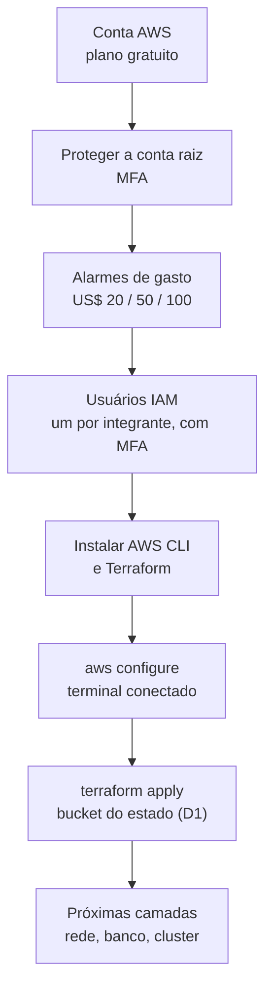

# AWS do zero — da conta criada até o primeiro `terraform apply`

> **Para quem é.** Quem nunca configurou uma nuvem. Parte de uma conta AWS recém-criada no
> plano gratuito e termina com o bucket do estado do Terraform (tarefa D1) criado e
> funcionando. Cada passo diz **o que é**, **por que importa** e **como confirmar que deu certo**.
>
> **Onde o texto pode envelhecer.** O console da AWS muda de layout com frequência. Os nomes
> dos menus e botões aqui são os que existiam na escrita; se algum mudar, procure pelo nome do
> serviço na barra de busca do console (no topo). Os comandos de terminal não dependem do layout.

## Sumário

0. [O que você vai fazer, em uma página](#0-o-que-você-vai-fazer-em-uma-página)
1. [Vocabulário mínimo](#1-vocabulário-mínimo)
2. [Entenda o seu plano gratuito (leia antes de gastar qualquer coisa)](#2-entenda-o-seu-plano-gratuito)
3. [Proteger a conta raiz](#3-proteger-a-conta-raiz)
4. [Escolher a região](#4-escolher-a-região)
5. [Alarmes de gasto (Budgets)](#5-alarmes-de-gasto-budgets)
6. [Criar usuários para a equipe (IAM)](#6-criar-usuários-para-a-equipe-iam)
7. [Instalar as ferramentas no Windows](#7-instalar-as-ferramentas-no-windows)
8. [Conectar o terminal à AWS](#8-conectar-o-terminal-à-aws)
9. [Criar o bucket do estado (tarefa D1)](#9-criar-o-bucket-do-estado-tarefa-d1)
10. [Regras de ouro de custo e segurança](#10-regras-de-ouro-de-custo-e-segurança)
11. [Quando algo dá errado](#11-quando-algo-dá-errado)
12. [O que vem depois](#12-o-que-vem-depois)

---

## 0. O que você vai fazer, em uma página



Tempo total: cerca de **1 hora**, a maior parte esperando e-mails e instalações.
**Custo do que você faz neste guia: praticamente zero** (um bucket vazio custa centavos por mês).

> **Divisão de papéis.** Os passos 3, 4, 5 e 6 são feitos **uma vez, por uma pessoa** (o dono
> da conta). Os passos 7, 8 e 9 são feitos **no computador de quem vai rodar o Terraform**. O
> passo 9 também é feito uma vez só para o projeto.
>
> Se alguém da equipe já fez a parte de proteção da conta (MFA, Budgets e usuários IAM), confira
> cada item em vez de refazer.

---

## 1. Vocabulário mínimo

| Termo | O que é, em português claro |
|---|---|
| **Conta AWS** | O "prédio" onde tudo é criado e de onde vem a cobrança. |
| **Usuário raiz (root)** | O e-mail e senha com que você criou a conta. Pode **tudo**, inclusive fechar a conta. Fica trancado num cofre e quase nunca é usado. |
| **IAM** | O serviço de **quem pode fazer o quê**. Cria usuários, grupos e permissões. |
| **Usuário IAM** | Uma pessoa com login próprio e permissões limitadas. É com ele que você trabalha no dia a dia. |
| **MFA** | Segundo fator de login (um código no celular). Obrigatório aqui: sem ele, roubar uma senha é suficiente para invadir a conta. |
| **Região** | Onde, geograficamente, os recursos ficam (`us-east-1` = Norte da Virgínia). Preços e serviços variam por região. Usaremos **sempre `us-east-1`**. |
| **Chave de acesso (access key)** | Um par "ID + segredo" que o terminal usa no lugar de senha. **Equivale a uma senha**: quem a tiver age como você. |
| **AWS CLI** | O programa `aws` que fala com a nuvem pelo terminal. |
| **Terraform** | Lê arquivos `.tf` que **descrevem** a infraestrutura e a cria na AWS. Em vez de clicar no console, você versiona o que quer. |
| **Estado do Terraform** | O arquivo onde ele anota o que já criou. Se for perdido, ele "esquece" seus recursos. Por isso fica num bucket protegido (D1). |
| **S3 / bucket** | Armazenamento de arquivos. Um *bucket* é uma "pasta" de nível máximo. |
| **Budgets** | Alarmes que mandam e-mail quando o gasto passa de um valor. |

---

## 2. Entenda o seu plano gratuito

Fatos conferidos na documentação da AWS (links no final):

- Você recebe **US$ 100 de crédito ao abrir a conta** e pode ganhar **até US$ 100 a mais**
  concluindo atividades de iniciação no console (por exemplo, criar um banco RDS simples). O
  projeto parte de **US$ 200 em créditos**.
- O **plano gratuito** dura **6 meses ou até os créditos acabarem**, o que vier primeiro.
- **Quando o plano gratuito acaba, a conta é encerrada automaticamente.** Os dados ficam
  guardados por 90 dias, e você pode **migrar para o plano pago** nesse período para continuar.
  Créditos que sobrarem são aplicados às próximas faturas.
- O plano gratuito **bloqueia serviços que poderiam consumir os créditos rapidamente**. A
  AWS não lista o EKS entre os bloqueados nas fontes que consultei, mas **isto precisa ser
  confirmado na prática** (ver o aviso abaixo).
- No plano gratuito você **não paga nada além dos créditos**; no pago, o que passar dos
  créditos vira cobrança no cartão.
- ⚠️ **Entrar no AWS Organizations converte a conta em plano pago automaticamente.** Isso
  também vale para o **IAM Identity Center** (ex-AWS SSO), que depende do Organizations. **Não
  use esses serviços.** Por isso este guia usa usuários IAM comuns.

> **Como saber quanto crédito você tem:** console → barra de busca → **Billing and Cost
> Management**. A página inicial mostra o saldo de créditos e o tempo restante do plano.
> Anote os dois números agora.

> **Aviso sobre o EKS.** O plano do projeto assume que o EKS funciona no plano gratuito. Se, ao
> criar o cluster, a AWS recusar com uma mensagem sobre o plano da conta, a saída é **atualizar
> para o plano pago** (*Billing → Free Tier → Upgrade plan*). Isso **não perde os créditos**,
> mas **passa a cobrar no cartão depois que eles acabarem**, então o passo 5 (alarmes) fica ainda
> mais importante. Decida isso só quando chegar lá, e **com a equipe**.

---

## 3. Proteger a conta raiz

**Por quê.** A conta raiz é a chave mestra. Se alguém roubar a sua senha e não houver segundo
fator, pode criar recursos caros, apagar tudo ou fechar a conta.

### 3.1 Ligar o MFA na conta raiz

1. Entre em https://console.aws.amazon.com/ como **usuário raiz** (e-mail e senha da conta).
2. No canto superior direito, clique no **nome da conta** → **Security credentials**
   (Credenciais de segurança).
3. Em **Multi-factor authentication (MFA)**, clique em **Assign MFA device**.
4. Escolha **Authenticator app** e siga o assistente: escaneie o QR code com um aplicativo
   autenticador no celular (Google Authenticator, Microsoft Authenticator, Authy, 1Password…) e
   digite **dois códigos consecutivos**.
5. Guarde o nome do dispositivo; ele aparece na lista de MFA.

**Como confirmar:** saia e entre de novo. O login deve pedir o código do aplicativo.

### 3.2 Boas práticas da conta raiz

- Use uma **senha longa e única** (gerenciador de senhas).
- **Não crie chaves de acesso para a conta raiz.** Se existir alguma, apague.
- Depois deste guia, **pare de usar a raiz**. Ela só volta para: alterar o plano, fechar a conta
  e coisas que o IAM não alcança.

---

## 4. Escolher a região

No canto superior direito do console, ao lado do seu nome, há o seletor de região. Escolha
**US East (N. Virginia) — `us-east-1`**.

**Por quê.** É a região mais barata e a que o projeto usa. Todo recurso criado vale **só para a
região selecionada**: se você "não encontrar" algo que criou, quase sempre é a região errada.

---

## 5. Alarmes de gasto (Budgets)

**Por quê.** É o seu cinto de segurança. Na nuvem, esquecer algo ligado gera cobrança; o alarme
avisa por e-mail antes que vire problema. O plano do projeto usa **US$ 20, US$ 50 e US$ 100**.

> **O que o Budgets mede.** Queremos que o alarme dispare pelo **consumo**, mesmo que ele saia do
> crédito e não do cartão: assim você sabe o ritmo de gasto. Para isso, o orçamento **não pode
> descontar os créditos**; se descontar, o custo líquido fica em zero enquanto houver crédito e o
> alarme nunca dispara. Ao criar o orçamento, abra **Cost types** (ou *Advanced settings*) e
> confira que **Credits** (e Refunds) **estão desmarcados**. O modelo simplificado do console pode
> ter um padrão diferente do esperado; na dúvida, confira. (O Terraform do D2 já cria os
> orçamentos com os créditos desmarcados.)

### 5.1 Habilitar o acesso do IAM ao faturamento (uma vez)

Para que usuários IAM vejam custos e Budgets, a conta raiz precisa permitir:

1. Como **raiz**, clique no nome da conta → **Account**.
2. Role até **IAM user and role access to Billing information** → **Edit** → marque
   **Activate IAM Access** → **Update**.

### 5.2 Criar os três orçamentos

1. Barra de busca → **Budgets** → **Create budget**.
2. Escolha **Use a template (simplified)** → **Monthly cost budget**.
3. Preencha:
   - **Budget name:** `automecanic-alerta-20`
   - **Enter your budgeted amount ($):** `20`
   - **Email recipients:** o e-mail de **todos** que devem ser avisados (separados por vírgula).
4. **Create budget**.
5. **Repita** para `automecanic-alerta-50` (50) e `automecanic-alerta-100` (100).

O modelo simplificado já cria um alerta quando o **custo real passa de 85%** do valor e outro
quando passa de **100%**, além de um alerta de **previsão**.

**Como confirmar:** a lista de orçamentos mostra os três. Os e-mails chegam como confirmação de
inscrição; confirme se a AWS pedir.

> Os orçamentos **avisam, mas não impedem** gastos. Quem impede é você, seguindo a
> [seção 10](#10-regras-de-ouro-de-custo-e-segurança).

---

## 6. Criar usuários para a equipe (IAM)

**Por quê.** Cada pessoa trabalha com o próprio usuário e o próprio MFA. Assim cada ação fica
registrada em nome de alguém, e dá para desligar o acesso de uma pessoa sem mexer nas outras.

### 6.1 Criar um grupo com permissões

1. Barra de busca → **IAM** → **User groups** → **Create group**.
2. **Group name:** `equipe-automecanic`.
3. Em **Attach permissions policies**, marque **`AdministratorAccess`**.
4. **Create group**.

> **Por que Administrator?** O Terraform vai criar rede, banco, cluster Kubernetes e papéis de
> permissão. Escrever a permissão mínima de cada um é um trabalho à parte e propenso a erro numa
> primeira vez. Num projeto de estudo com três pessoas, o administrador **protegido por MFA** é o
> compromisso razoável. Em produção real, seria uma política restrita. Isso fica registrado como
> uma limitação consciente.

### 6.2 Criar um usuário por integrante

Para **cada pessoa** da equipe:

1. **IAM** → **Users** → **Create user**.
2. **User name:** o nome da pessoa, por exemplo `matheus`.
3. Marque **Provide user access to the AWS Management Console** → **I want to create an IAM
   user**.
4. Defina uma senha provisória e marque **Users must create a new password at next sign-in**.
5. Avance, **adicione o usuário ao grupo `equipe-automecanic`** e conclua.
6. Anote (ou copie) o **endereço de login da conta**, que tem a forma
   `https://<numero-da-conta>.signin.aws.amazon.com/console`. A própria pessoa precisa dele.

### 6.3 Cada pessoa ativa o próprio MFA

1. Entre com o endereço de login da conta, o usuário e a senha provisória; defina a senha nova.
2. Clique no **nome do usuário** → **Security credentials** → **Assign MFA device** e repita o
   assistente do passo 3.1.

**Como confirmar:** em **IAM → Users**, a coluna **MFA** de cada usuário mostra o dispositivo.

### 6.4 Criar a chave de acesso (para o terminal)

Só quem vai rodar comandos no terminal precisa. Com o **seu usuário IAM** (não a raiz):

1. **Nome do usuário** → **Security credentials** → **Access keys** → **Create access key**.
2. Escolha **Command Line Interface (CLI)**, marque a confirmação e avance.
3. Copie o **Access key ID** e o **Secret access key** (o segredo **só aparece agora**). Se
   perder, apague a chave e crie outra.

> ⚠️ **A chave de acesso é uma senha sem MFA.** Regras:
> - **Nunca** em arquivo do repositório, em mensagem, em print ou no código.
> - Só no computador de quem a criou, guardada pelo `aws configure` (seção 8).
> - Se vazar: **IAM → seu usuário → Security credentials → Make inactive** e apague.
> - O **GitHub Actions não usará chave** (usará OIDC, tarefa D2/E2): é por isso que o pipeline
>   não terá nenhum segredo da AWS para vazar.

---

## 7. Instalar as ferramentas no Windows

Abra o **PowerShell**.

### 7.1 AWS CLI

```powershell
winget install --id Amazon.AWSCLI -e
```

**Feche e reabra o PowerShell** (para o `PATH` atualizar) e confirme:

```powershell
aws --version
```

Deve mostrar `aws-cli/2.x.x`.

### 7.2 Terraform

```powershell
winget install --id Hashicorp.Terraform -e
```

Feche e reabra o PowerShell:

```powershell
terraform version
```

Precisa ser **1.10 ou superior** (a trava `use_lockfile` do projeto exige). Se vier uma versão
menor, atualize: `winget upgrade Hashicorp.Terraform`.

### 7.3 Já instalados (verifique)

```powershell
git --version
docker --version
kubectl version --client
```

> Se o `winget` não existir ou falhar, baixe os instaladores nos sites oficiais:
> https://aws.amazon.com/cli/ e https://developer.hashicorp.com/terraform/install.

---

## 8. Conectar o terminal à AWS

### 8.1 Configurar um perfil

```powershell
aws configure --profile automecanic
```

O programa faz quatro perguntas:

| Pergunta | O que responder |
|---|---|
| `AWS Access Key ID` | O ID copiado no passo 6.4 |
| `AWS Secret Access Key` | O segredo copiado no passo 6.4 |
| `Default region name` | `us-east-1` |
| `Default output format` | `json` |

Isso grava um arquivo em `C:\Users\<você>\.aws\credentials`. **Esse arquivo é a sua chave:**
nunca o envie a ninguém.

### 8.2 Usar o perfil

Para não repetir `--profile` em todo comando, defina-o na sessão atual do PowerShell:

```powershell
$env:AWS_PROFILE = "automecanic"
```

(Precisa ser refeito em cada janela nova; para tornar permanente: `setx AWS_PROFILE automecanic`
e reabra o terminal.)

### 8.3 Testar

```powershell
aws sts get-caller-identity
```

Resposta esperada, com os **seus** dados:

```json
{
    "UserId": "AIDA...",
    "Account": "123456789012",
    "Arn": "arn:aws:iam::123456789012:user/matheus"
}
```

**Confira duas coisas:** o `Arn` termina com **o seu usuário** (e **não** `:root`), e o
`Account` é o número da conta do projeto.

**Se falhar:**
- `Unable to locate credentials`: o perfil não está ativo; refaça 8.2.
- `InvalidClientTokenId` ou `SignatureDoesNotMatch`: a chave foi digitada errada ou está
  inativa; refaça 8.1 com uma chave nova.
- `AccessDenied`: o usuário não está no grupo `equipe-automecanic`.

---

## 9. Criar o bucket do estado (tarefa D1)

Esta etapa é feita **uma vez, por uma pessoa**. O passo a passo completo e as verificações estão
em [`infra/00-bootstrap/README.md`](../infra/00-bootstrap/README.md); aqui está o essencial.

### 9.1 O que será criado

Um único **bucket S3** chamado `automecanic-tfstate-<número da conta>`, privado, versionado e
criptografado. Custa **centavos por mês**. Ele guarda a "memória" do Terraform para as próximas
camadas (rede, banco, cluster).

### 9.2 Criar

```powershell
cd "C:\Users\Matheus\Documents\Arquitetura de Software - Pós\Projeto\AutoMecanic\infra\00-bootstrap"
terraform init
terraform plan
```

- O `init` baixa o plugin da AWS (cerca de 100 MB; leva um pouco).
- O `plan` **só mostra o que faria, sem criar nada**. Leia a saída. Deve terminar com
  **`Plan: 7 to add, 0 to change, 0 to destroy.`** e o nome do bucket com o **seu** número de
  conta. Se mostrar outra quantidade ou algo para destruir, **pare e peça ajuda**.

Se estiver tudo certo:

```powershell
terraform apply
```

Ele repete o plano e pergunta `Do you want to perform these actions?`. Digite **`yes`**.

**Como confirmar:** termina com `Apply complete! Resources: 7 added` e mostra os *outputs*. Anote:

```powershell
terraform output nome_do_bucket
```

Você também pode ver o bucket no console: **S3** (região `us-east-1`).

### 9.3 Mover o estado do bootstrap para o próprio bucket

Neste momento o estado deste passo está **só no seu computador**, num arquivo
(`terraform.tfstate`). Se o computador quebrar, o Terraform esquece que criou o bucket. Para
resolver, guarde o estado dentro do bucket:

```powershell
Copy-Item backend.tf.exemplo backend.tf
notepad backend.tf          # troque <NOME-DO-BUCKET> pelo output do passo anterior
terraform init -migrate-state
```

O Terraform pergunta se deve copiar o estado existente para o novo backend: responda **`yes`**.

Confirme que o estado está remoto e apague a cópia local:

```powershell
aws s3 ls "s3://<NOME-DO-BUCKET>/00-bootstrap/"
Remove-Item terraform.tfstate, terraform.tfstate.backup
```

O `aws s3 ls` deve listar o arquivo `terraform.tfstate`.

### 9.4 Fazer commit do `backend.tf`

O `backend.tf` **não tem segredo** (só o nome do bucket) e deve ir para o git:

```powershell
git add infra/00-bootstrap/backend.tf
git commit -m "infra: backend remoto do bootstrap"
```

(O `terraform.tfstate` e a pasta `.terraform/` **nunca** vão para o git: o `.gitignore` já
cuida disso.)

### 9.5 Teste final da tarefa D1

```powershell
terraform plan
```

Deve dizer **`No changes. Your infrastructure matches the configuration.`**, agora lendo o
estado do S3. Está pronto. Avise para marcarmos o D1 como concluído.

---

## 10. Regras de ouro de custo e segurança

### Custo

1. **Tudo o que o Terraform cria, o Terraform destrói.** Nunca apague recursos "no clique" no
   console: o Terraform ficaria com um estado errado.
2. O que **custa por hora** (o cluster EKS, os nós, o load balancer) só deve existir **enquanto
   alguém estiver usando**. A camada `20-cluster` foi desenhada para ser criada e destruída.
3. Estimativa ligada 24 h: **~US$ 0,25 por hora, ~US$ 185 por mês**. Com US$ 200 de crédito,
   um ambiente esquecido ligado **consome tudo em cerca de um mês**.
4. **Ao terminar de trabalhar**, rode `terraform destroy` na camada do cluster e confira no
   console se não sobrou nada (EC2, Load Balancers, NAT Gateways, Elastic IPs).
5. Olhe **Billing → Bills** e **Cost Explorer** pelo menos uma vez por semana.
6. **IPv4 público custa dinheiro** (~US$ 0,005/hora cada). Recursos "esquecidos" com IP público
   são uma fonte clássica de cobrança.

### Segurança

1. MFA em **todos** os usuários, inclusive o seu.
2. Chave de acesso **nunca** no git, em mensagens ou prints.
3. Uma pessoa não usa o usuário da outra.
4. Sai alguém da equipe: **desative o usuário e as chaves** no IAM no mesmo dia.
5. Se desconfiar de vazamento: **desative a chave primeiro, investigue depois**.

---

## 11. Quando algo dá errado

| Sintoma | Provável causa e solução |
|---|---|
| Não acho um recurso que criei no console | Região errada. Confira o seletor no topo (`us-east-1`). |
| `terraform` ou `aws` "não é reconhecido" | O PowerShell foi aberto antes da instalação. Feche e abra de novo. |
| `terraform init` fica parado baixando | O plugin da AWS tem ~100 MB; espere. Se travar por minutos, verifique a internet/VPN/proxy. |
| `Error: No valid credential sources found` | O perfil não está ativo. `$env:AWS_PROFILE = "automecanic"` e teste `aws sts get-caller-identity`. |
| `BucketAlreadyExists` | O nome colidiu. Use `terraform apply -var nome_do_bucket=<outro-nome-unico>`. |
| `Unsupported argument "use_lockfile"` | Terraform abaixo da 1.10. `winget upgrade Hashicorp.Terraform`. |
| `AccessDenied` em algo do console | Usuário fora do grupo, ou o acesso do IAM ao faturamento (passo 5.1) não foi ativado. |
| Cobrança inesperada | Pare tudo: `terraform destroy` do cluster e confira o **Cost Explorer**, agrupando por **Serviço**. |
| Perdi o celular do MFA | Pelo usuário raiz, redefina o MFA de um usuário IAM. Para a própria raiz, use a recuperação da AWS (com o e-mail e telefone da conta). **Cadastre um segundo dispositivo MFA** para evitar isso. |

---

## 12. O que vem depois

Com o D1 concluído, o caminho é:

| Etapa | O que faz | Custo enquanto existe |
|---|---|---|
| **D2 · `10-base`** | Rede, repositório de imagens (ECR), banco RDS, papel OIDC do CI | ~US$ 0,05 por hora (o RDS é o principal) |
| **D3 · `20-cluster`** | Cluster EKS e nós | ~US$ 0,20 por hora |
| **C3 · overlay `aws`** | Manifestos para o cluster real | — |
| **E1 a E3 · GitHub Actions** | Build, deploy automático e destruição agendada do cluster | — |

Antes de começar o D2, vale **verificar a lista de serviços do plano gratuito** da conta (seção
2) e decidir **com a equipe** se vale migrar para o plano pago.

---

## Fontes

- [Choosing a plan — AWS Billing](https://docs.aws.amazon.com/awsaccountbilling/latest/aboutv2/free-tier-plans.html):
  plano gratuito x pago, créditos, encerramento da conta e conversão pelo Organizations.
- [AWS Free Tier FAQs](https://aws.amazon.com/free/faqs/)
- [AWS Free Tier update: up to $200 in credits](https://aws.amazon.com/blogs/aws/aws-free-tier-update-new-customers-can-get-started-and-explore-aws-with-up-to-200-in-credits)
- [Termos do AWS Free Tier](https://aws.amazon.com/free/terms)

---

**Voltar:** [Guia de testes](07-guia-de-testes.md) · [Bootstrap do Terraform](../infra/00-bootstrap/README.md)
