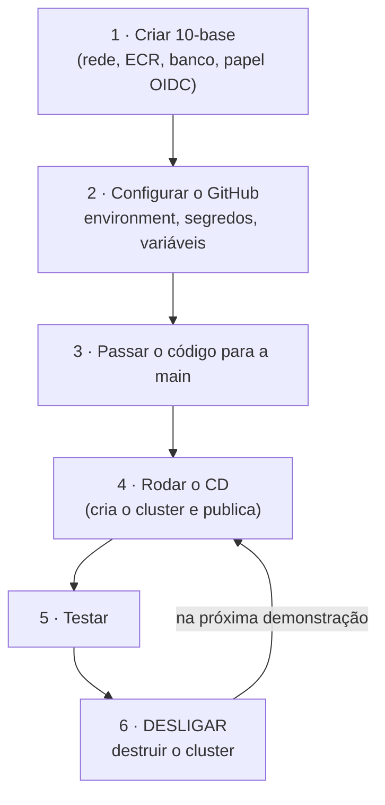

# Guia do deploy na AWS (CI/CD)

> **O que é.** O passo a passo para ligar o pipeline que publica o AutoMecanic na AWS — do que
> configurar no GitHub até rodar o deploy — e, **em cada etapa, como desligar para não gerar
> custo**. Pressupõe o [guia AWS do zero](08-guia-aws-do-zero.md) concluído (conta protegida,
> usuário IAM, AWS CLI e Terraform instalados, bucket do estado criado).

## Sumário

- [Antes de tudo: o que custa dinheiro](#antes-de-tudo-o-que-custa-dinheiro)
- [Visão geral do caminho](#visão-geral-do-caminho)
- [Passo 1 · Criar a base na AWS (`10-base`)](#passo-1--criar-a-base-na-aws-10-base)
- [Passo 2 · Configurar o GitHub](#passo-2--configurar-o-github)
- [Passo 3 · Passar o repositório para a `main`](#passo-3--passar-o-repositório-para-a-main)
- [Passo 4 · Rodar o deploy](#passo-4--rodar-o-deploy)
- [Passo 5 · Testar o que foi publicado](#passo-5--testar-o-que-foi-publicado)
- [Passo 6 · Desligar](#passo-6--desligar)
- [Alternativa: fazer à mão, sem o pipeline](#alternativa-fazer-à-mão-sem-o-pipeline)
- [Checklist final de custo](#checklist-final-de-custo)
- [Problemas comuns](#problemas-comuns)

---

## Antes de tudo: o que custa dinheiro

| O que | Quanto | Quando cobra |
|---|---|---|
| Cluster EKS (plano de controle) | US$ 0,10/h | Enquanto existir, mesmo sem nada rodando |
| 2 nós `t3.medium` | ~US$ 0,083/h | Enquanto o cluster existir |
| Load balancer (NLB) | ~US$ 0,025/h | Enquanto o `Service` existir |
| IPs públicos dos nós | ~US$ 0,01/h | Enquanto os nós existirem |
| **Subtotal "ligado"** | **~US$ 0,25/h → ~US$ 6/dia → ~US$ 185/mês** | |
| Banco RDS (`10-base`) | ~US$ 0,019/h (~US$ 14/mês) + armazenamento | **Enquanto existir, ligado ou parado** |
| Repositório ECR | centavos | Pelas imagens guardadas |
| Bucket do estado | centavos | Sempre |

**Com US$ 200 de crédito, um cluster esquecido ligado consome tudo em cerca de um mês.** E, no
plano gratuito, **a conta é encerrada quando os créditos acabam**. A regra deste guia é uma só:

> **Só deixe ligado o que está em uso. Ao terminar, destrua o cluster.** O pipeline tem um
> workflow que faz isso sozinho toda madrugada (passo 6).

---

## Visão geral do caminho



O ciclo do dia a dia é **4 → 5 → 6**. Os passos 1 a 3 são feitos uma vez.

---

## Passo 1 · Criar a base na AWS (`10-base`)

É a camada que o pipeline precisa para existir: ela cria o papel que o GitHub vai assumir. Siga
[`infra/10-base/README.md`](../infra/10-base/README.md) (que já inclui como importar ou desligar
os alarmes de gasto). Resumo:

```powershell
cd infra\10-base
Copy-Item terraform.tfvars.exemplo terraform.tfvars
notepad terraform.tfvars          # e-mails dos alarmes
terraform init
terraform plan                    # leia; nada deve ser destruído
terraform apply
```

Anote os dois valores que o GitHub vai precisar:

```powershell
terraform output -raw ci_papel_arn         # vira o segredo AWS_ROLE_ARN
aws sts get-caller-identity --query Arn --output text    # o SEU ARN (para a lista de administradores)
```

> 💰 **A partir daqui o RDS cobra (~US$ 14/mês), ligado ou não.**
>
> **Desligar este passo:** se não for usar por mais de uma semana,
> `cd infra\10-base ; terraform destroy` (depois de destruir o cluster, se ele existir). Isso
> apaga o banco e os dados; o próximo `apply` recria tudo. Para pausas curtas, o RDS pode ser
> parado por até 7 dias (`aws rds stop-db-instance --db-instance-identifier automecanic-banco`),
> mas o armazenamento continua cobrando e a AWS o religa sozinha depois de 7 dias.

---

## Passo 2 · Configurar o GitHub

Tudo em **Settings** do repositório (é preciso ser administrador dele).

### 2.1 Criar o ambiente `aws` (com aprovação manual)

1. **Settings → Environments → New environment**, nome **`aws`** (exatamente assim).
2. Marque **Required reviewers** e adicione quem pode aprovar um deploy (você e a equipe).
3. Em **Deployment branches and tags**, escolha **Selected branches and tags** e adicione:
   - a branch **`main`**;
   - a regra de tag **`v*`**.

> ⚠️ **O passo 3 é de segurança, não é opcional.** O papel da AWS aceita qualquer job que use o
> ambiente `aws`, de qualquer branch. Sem restringir as branches aqui, alguém com acesso de
> escrita ao repositório poderia criar uma branch, usar o ambiente `aws` e obter credenciais de
> **administrador** da sua conta. A aprovação manual e a restrição de branches são a trava.

### 2.2 Segredos (valores secretos)

**Settings → Secrets and variables → Actions → Secrets → New repository secret**:

| Segredo | Valor |
|---|---|
| `AWS_ROLE_ARN` | A saída de `terraform output -raw ci_papel_arn` |
| `JWT_CHAVE` | Uma chave de 32+ caracteres. Gere: `openssl rand -base64 48` |
| `SEED_SENHA_ADMIN` | A senha do administrador da API (8+ caracteres, maiúscula, minúscula, dígito e símbolo) |
| `SMTP_USUARIO` | O Gmail que envia os e-mails (e é o remetente) |
| `SMTP_SENHA` | A **senha de app** do Gmail (veja abaixo) |

**Senha de app do Gmail:** na conta Google → **Segurança** → ative a **Verificação em duas
etapas** → **Senhas de app** → crie uma (nome: `automecanic`). O Google mostra 16 caracteres uma
vez: copie para o segredo. **Para desligar:** na mesma tela, remova a senha de app.

> Estes são segredos de um projeto de estudo. **Nunca** os escreva no repositório, em
> mensagens ou prints.

### 2.3 Variáveis (valores que não são secretos)

Na mesma tela, aba **Variables → New repository variable**:

| Variável | Valor | Para quê |
|---|---|---|
| `ADMINISTRADORES` | Lista JSON dos ARNs da equipe, ex.: `["arn:aws:iam::123456789012:user/matheus","arn:aws:iam::123456789012:user/colega"]` | Quem usa o `kubectl` no cluster. **Igual** à lista usada no `terraform apply` local |
| `EMAILS_DE_ALERTA` | Lista JSON, ex.: `["voce@exemplo.com"]` | Alarmes de gasto. **Igual** ao `terraform.tfvars` da camada `10-base` |
| `CRIAR_ORCAMENTOS` | `true` ou `false` | **Igual** ao que você usou no `10-base` (`false` se os alarmes são manuais) |
| `CD_HABILITADO` | `true` **só quando quiser** que cada push na `main` dispare o deploy | Ver abaixo |

> Os valores de `ADMINISTRADORES`, `EMAILS_DE_ALERTA` e `CRIAR_ORCAMENTOS` precisam ser os mesmos
> dos `terraform apply` feitos à mão. Se forem diferentes, o pipeline **altera** esses recursos
> (por exemplo, trocaria os administradores do cluster).

**Sobre `CD_HABILITADO`:** é um **freio de custo**. Enquanto não for `true`, um push na `main`
**não faz nada** (só o disparo manual funciona). Deixe **desligado** e dispare à mão quando for
demonstrar; ligue só se quiser deploy automático.
**Para desligar o deploy automático:** apague a variável ou ponha `false`.

### 2.4 Conferir

Na tela de segredos devem aparecer 5 nomes; nas variáveis, de 3 a 4; em **Environments**, o `aws`
com revisores e branches restritas.

---

## Passo 3 · Passar o repositório para a `main`

Os workflows `cd.yml` e `destruir-cluster.yml` só aparecem na aba **Actions** (e o agendamento só
vale) quando estão na **branch padrão (`main`)**.

1. Abra um **Pull Request** de `feat/DevMatheus` para `main` e espere o **CI** ficar verde. Ele
   valida o código, os manifestos do Kubernetes e o Terraform.
2. Faça o merge.
3. Em **Actions**, confirme que existem os workflows **CI**, **CD** e **Destruir cluster**.

> 💰 **Cuidado com o agendamento.** O *Destruir cluster* passa a rodar **toda madrugada** (06:00
> UTC = 03:00 em Brasília) assim que está na `main`. Isso é o que protege o seu crédito. Se o
> segredo `AWS_ROLE_ARN` ainda não existir, ele apenas avisa e não falha.

---

## Passo 4 · Rodar o deploy

1. **Actions → CD → Run workflow** (branch `main`) → **Run workflow**.
2. O job **Compilação e testes** roda sozinho (~3 min).
3. O job **Implantar na AWS** fica **esperando aprovação**. Quem for revisor do ambiente `aws`
   clica em **Review deployments → aws → Approve and deploy**.
4. Depois de aprovado, o pipeline faz, nesta ordem:

| Etapa | O que faz | Tempo |
|---|---|---|
| Terraform `10-base` | Confirma/atualiza rede, ECR, banco | ~1 min |
| Publicar a imagem | Constrói e envia ao ECR (tag = commit; em release, também `vX.Y.Z`) | ~3 min |
| Terraform `20-cluster` | **Cria o cluster EKS** | **~15 a 20 min** |
| Conectar ao cluster | Espera os 2 nós ficarem `Ready` | ~2 min |
| Migrar e atualizar | Cria o Secret, roda o Job de migração, atualiza a API, cria o balanceador | ~5 min |
| Teste de fumaça | Roda as duas pastas do Postman contra o endereço público | ~1 min |

5. No fim, o **Resumo** da execução mostra o endereço (`http://<algo>.elb.us-east-1.amazonaws.com`).

> 💰 **A partir do momento em que o cluster nasce, cobra ~US$ 0,25/hora.** O deploy completo leva
> ~35 minutos. **Quando terminar de testar, vá para o passo 6.**

### Lançar uma versão (`v2.0.0`)

Depois de a entrega estar pronta: `git tag v2.0.0` e `git push origin v2.0.0`. A tag dispara o CD
(se `CD_HABILITADO` for `true`) e a imagem também recebe a tag `v2.0.0` no ECR.

---

## Passo 5 · Testar o que foi publicado

Com o endereço do resumo (ou: `kubectl -n automecanic get service automecanic-api`):

- `http://<endereço>/health/pronto` deve responder 200 (o DNS leva 1 a 3 min).
- `http://<endereço>/swagger` abre a documentação.
- Faça login com `admin@automecanic.com.br` e a senha do segredo `SEED_SENHA_ADMIN`.
- Rode a coleção Postman apontando para o endereço, como em [`k8s/overlays/aws/README.md`](../k8s/overlays/aws/README.md).
- Confira o e-mail real no Gmail após abrir uma OS com um e-mail do cliente que você controle.
- Teste de carga do HPA: veja a seção "Teste de carga" do README do overlay AWS.

Para usar o `kubectl` no seu computador:

```powershell
cd infra\20-cluster
terraform init
terraform output -raw comando_do_kubeconfig | Invoke-Expression
kubectl get pods -n automecanic
```

> **Limitação conhecida:** o acesso é só por **HTTP**, sem certificado. Serve para a
> demonstração; não envie dados reais.

---

## Passo 6 · Desligar

### 6.1 Desligar agora (o mais importante)

**Actions → Destruir cluster → Run workflow** (deixe `destruir_base` **desmarcado**).

Ele faz, nesta ordem: remove a aplicação e o **load balancer** (que o Kubernetes criou), **espera
o balanceador sumir**, e só então destrói o cluster com o Terraform. Leva ~10 a 15 minutos. Ao
final, o **Resumo** lista o que sobrou na conta; as linhas de cluster, instâncias, balanceadores
e IPs devem estar **vazias**.

> **Por que o balanceador sai antes?** Ele não é do Terraform: foi criado pelo Kubernetes. Se o
> cluster for destruído com ele de pé, ele fica **órfão**, **continua cobrando** e **impede a
> exclusão da VPC**.

### 6.2 Desligar automaticamente

O workflow **Destruir cluster** também roda **toda madrugada** (03:00 de Brasília) sozinho. É a
sua rede de segurança caso você esqueça de desligar. **Não o desative** enquanto houver risco de
esquecimento.

### 6.3 Desligar tudo, inclusive o banco

Quando não for usar por dias: **Actions → Destruir cluster → Run workflow** e marque
**`destruir_base`**. Isso apaga também o **banco e os dados**, o repositório de imagens e a VPC.
O próximo deploy recria tudo (e o seed repovoa o banco).

### 6.4 Conferir que nada está cobrando

No **console da AWS** (região **us-east-1**), todos devem estar **vazios**:

| Onde | O que verificar |
|---|---|
| **EKS → Clusters** | nenhum cluster |
| **EC2 → Instances** | nenhuma em execução |
| **EC2 → Load Balancers** | nenhum |
| **VPC → Elastic IPs** | nenhum alocado |
| **EC2 → Volumes** | nenhum volume solto |
| **RDS → Databases** | nenhum (se você destruiu o `10-base`) |

Ou pelo terminal:

```powershell
aws eks list-clusters
aws ec2 describe-instances --filters "Name=instance-state-name,Values=running" --query "Reservations[].Instances[].InstanceId"
aws elbv2 describe-load-balancers --query "LoadBalancers[].LoadBalancerName"
aws ec2 describe-addresses --query "Addresses[].PublicIp"
aws rds describe-db-instances --query "DBInstances[].DBInstanceIdentifier"
```

No dia seguinte, olhe **Billing → Bills** e o **Cost Explorer** (agrupe por **Serviço**): o custo
por hora deve ter caído a quase zero.

### 6.5 Desligar o acesso do pipeline à AWS

Se for ficar um bom tempo sem usar, ou suspeitar de vazamento:

- **GitHub:** apague o segredo `AWS_ROLE_ARN` (o pipeline deixa de conseguir entrar na AWS).
- **AWS:** `cd infra\10-base ; terraform destroy` remove o papel e o provedor OIDC.
- **Gmail:** remova a **senha de app** (Conta Google → Segurança → Senhas de app).

### 6.6 Se o *Destruir cluster* falhar

| Sintoma | O que fazer |
|---|---|
| "Um load balancer não sumiu a tempo" | Apague-o no console (EC2 → Load Balancers) e rode o workflow de novo. |
| `DependencyViolation` no destroy | Sobrou um balanceador ou interface de rede. Apague-o, espere ~5 min e rode de novo. |
| O workflow nem inicia | O segredo `AWS_ROLE_ARN` não existe, ou o workflow não está na `main`. Veja o **Resumo** da execução. |
| Nada funciona e o cluster está cobrando | **Plano B, à mão:** `kubectl delete -k k8s/overlays/aws`, espere o balanceador sumir e `cd infra\20-cluster ; terraform destroy`. Detalhes em [`infra/20-cluster/README.md`](../infra/20-cluster/README.md#desligar-e-parar-de-pagar). |

---

## Alternativa: fazer à mão, sem o pipeline

Útil para testar antes de configurar o GitHub, ou se o pipeline falhar. **Ordem:**

1. `infra/10-base`: `terraform apply` (passo 1).
2. `infra/20-cluster`: `terraform apply` (ver [`infra/20-cluster/README.md`](../infra/20-cluster/README.md)). 💰 cobra a partir daqui.
3. Imagem no ECR e `k8s/overlays/aws/aplicar.sh` (ver [`k8s/overlays/aws/README.md`](../k8s/overlays/aws/README.md)).
4. Testar.
5. **Desligar:** `kubectl delete -k k8s/overlays/aws`, esperar o balanceador sumir, `terraform destroy` em `20-cluster` (e em `10-base` se for ficar dias parado).

---

## Checklist final de custo

Antes de fechar o computador:

- [ ] O cluster foi destruído (`aws eks list-clusters` vazio)?
- [ ] Nenhum load balancer (`aws elbv2 describe-load-balancers` vazio)?
- [ ] Nenhum Elastic IP e nenhuma instância EC2 em execução?
- [ ] Se vai ficar mais de uma semana parado: o `10-base` também foi destruído (RDS)?
- [ ] O workflow noturno *Destruir cluster* continua ativo?
- [ ] Os alarmes do Budgets estão ativos e os e-mails certos?
- [ ] A senha de app do Gmail e as chaves de acesso da AWS estão guardadas (ou removidas, se não vai usar)?

---

## Problemas comuns

| Sintoma | Causa e solução |
|---|---|
| CD: "Faltam: secret …/variable …" | Falta configurar o item citado (passo 2). |
| CD: `Not authorized to perform sts:AssumeRoleWithWebIdentity` | O `AWS_ROLE_ARN` está errado, ou o job rodou de uma branch/tag não permitida. Confira o ambiente `aws` e que o job usa `main` ou uma tag `v*`. |
| CD fica "Waiting" para sempre | Aguarda a aprovação do ambiente `aws` (passo 4.3). |
| `terraform apply` altera os administradores ou os alarmes | As variáveis do GitHub diferem das usadas à mão (passo 2.3). Alinhe-as. |
| EKS recusado por causa do plano da conta | O plano gratuito pode bloquear o serviço; migrar para o pago é decisão da equipe (veja o guia AWS do zero, seção 2). |
| Newman falha com `429` | Limite de taxa. Rode as pastas uma de cada vez; o limite é por IP e por minuto. |
| E-mails não chegam | Confira `SMTP_USUARIO`/`SMTP_SENHA` (senha **de app**, não a senha da conta) e os logs: `kubectl -n automecanic logs deploy/automecanic-api`. |
| Mesclei na `main` e rodou um deploy sem eu querer | `CD_HABILITADO` estava `true`. Apague a variável, **cancele a execução** em Actions e rode o *Destruir cluster*. |
| O endereço do balanceador mudou | Normal: ele muda a cada vez que o cluster é recriado. |

---

**Voltar:** [AWS do zero](08-guia-aws-do-zero.md) · [Guia de testes](07-guia-de-testes.md)
