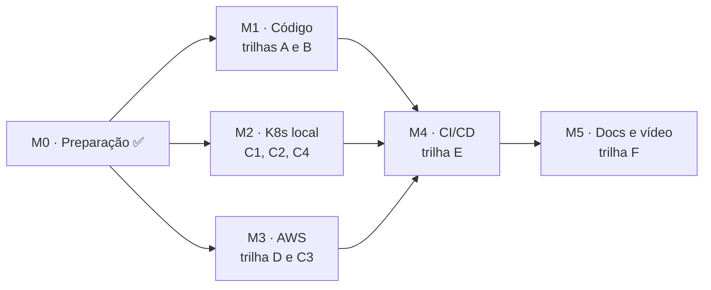

# Plano de Implementação — Fase 2

Plano de trabalho para evoluir o AutoMecanic da Fase 1 para os requisitos da Fase 2 do Tech
Challenge: qualidade de código, APIs novas, Kubernetes, Terraform e CI/CD na AWS.

> Documento de referência da equipe. Atualize a coluna de situação das tarefas conforme
> elas forem concluídas.

---

## Decisões tomadas

| Tema | Decisão |
|---|---|
| Nuvem | AWS, conta no *free plan* com US$ 200 em créditos (sem o free tier legado de 12 meses) |
| Cluster | **EKS** (disponível no free plan), criado e destruído sob demanda |
| Banco | **RDS PostgreSQL 17**, db.t4g.micro, em subnet privada |
| Registro de imagens | **ECR** |
| Desenvolvimento local | Cluster **kind**, com os mesmos manifestos (Kustomize) |
| Aprovação do orçamento pelo cliente | **Rota simples na API**, protegida por número da OS + CPF/CNPJ (sem webhook) |
| E-mail | **SMTP genérico** (MailKit); Gmail com senha de app no cluster, Mailpit em desenvolvimento |
| Entrega do e-mail | **Outbox** transacional + *worker*; pode ser reavaliada depois sem afetar o restante |
| Listagem de OS | Exclui **Finalizadas, Entregues e Canceladas** |
| Versionamento | Tags no padrão **`vX.Y.Z`**: Fase 1 = `v1.0.0`; entrega da Fase 2 = `v2.0.0` |

### Custo estimado na AWS (us-east-1, sob demanda)

| Recurso | US$/hora | Ligado 24/7 por mês |
|---|---:|---:|
| Plano de controle do EKS | 0,10 | ~73 |
| 2 nós t3.medium | 0,083 | ~60 |
| RDS db.t4g.micro + 20 GB | 0,019 | ~14 |
| Load Balancer | ~0,025 | ~18 |
| IPv4 públicos (~5) | 0,025 | ~18 |
| **Total** | **~0,25** | **~185** |

Valores aproximados; confira na calculadora da AWS. Ligado direto, o ambiente consome os
créditos em cerca de um mês. Usado sob demanda, 100 horas custam cerca de US$ 25.

**Regra de custo:** o cluster EKS só existe enquanto alguém estiver usando. O desenvolvimento
do dia a dia é no kind, e um *workflow* agendado destrói o cluster toda madrugada.

---

## Como ler as tarefas

- **Tamanho:** **P** cabe em uma sessão de trabalho, **M** em duas ou três, **G** leva mais que isso.
- **Depende:** tarefas que precisam estar concluídas antes.
- **Situação:** ⬜ a fazer · 🟨 em andamento · ✅ concluída.

---

## M0 · Preparação ✅

| ID | Tarefa | Situação |
|---|---|:-:|
| P1 | Tag `v1.0.0` no commit da entrega da Fase 1 (`096e6dc`) | ✅ |
| P2 | Fluxo de branches: uma branch por tarefa, PR para a `main`, CI obrigatório no PR | ✅ |
| P3 | AWS: MFA na conta raiz, acesso IAM para os três integrantes, região `us-east-1`, alarmes no Budgets em US$ 20, 50 e 100 | ✅ |
| P4 | Gmail: verificação em duas etapas e senha de app | ✅ |
| P5 | Repositório compartilhado com o usuário `soat-architecture` | ✅ |

---

## Trilha A · Aplicação

| ID | Tarefa | Critério de pronto | Tam. | Depende | Situação |
|---|---|---|:-:|---|:-:|
| **A1** | **Dívidas técnicas:** corrigir os comentários que contradizem o código ([DependencyInjection.cs](../../src/AutoMecanic.Infrastructure/DependencyInjection.cs) — rastreamento; [Program.cs](../../src/AutoMecanic.Api/Program.cs) — filtro de ModelState); impedir que o cancelamento apague as datas de envio do orçamento (`OrdemServico.Cancelar`); emitir evento em `AlterarQuantidadeDeServico`; alinhar o comentário de `RemoverPeca` sobre `ItemRemovidoDaOrdem`; remover do README o link para o roteiro do vídeo excluído | Testes verdes; histórico do orçamento cancelado preservado | P | — | ⬜ |
| **A2** | **Relógio fora do domínio:** os métodos do domínio passam a receber `agora`; a aplicação usa `TimeProvider`; `BannedApiAnalyzers` proíbe `DateTimeOffset.UtcNow` no Domain | Nenhum `UtcNow` no Domain; testes de datas determinísticos | M | A1 | ⬜ |
| **A3** | **Um caso de uso por classe:** dividir `ServicoDeOrdensServico` em `AbrirOrdemServico`, `AprovarOrcamento`, `FinalizarServico` etc.; lógica comum de estoque em um colaborador interno; controllers recebem os casos de uso | Nenhuma classe da Application acima de ~200 linhas; testes migrados | G | A2 | ⬜ |
| **A4** | **Testes de arquitetura:** projeto `tests/AutoMecanic.ArchitectureTests` com NetArchTest (Domain sem dependências; Application sem EF nem ASP.NET; controllers sem `DbContext`) | Rodam no `dotnet test` e no CI | P | — | ✅ |
| **A5** | **Abertura de OS completa:** `/recepcao` aceita `servicos[]` e `pecas[]`; tudo na mesma transação, com reserva de estoque; resposta `201` com `id` e `numero` | Falta de estoque desfaz tudo, inclusive o número; testes de unidade e integração | M | A3 | ⬜ |
| **A6** | **Consulta de status:** `GET /ordens-servico/{id}/status` (autenticado), com payload leve | Teste de integração | P | A3 | ⬜ |
| **A7** | **Aprovação e recusa pelo cliente:** `POST /acompanhamento/orcamento/aprovar` e `/reprovar` com número da OS + CPF/CNPJ; limite de taxa próprio; resposta idêntica quando os dados não conferem | Recusa devolve as reservas; aprovar duas vezes retorna `422` | P | A3 | ⬜ |
| **A8** | **Listagem priorizada:** `GET /ordens-servico` ordena Em Execução > Aguardando Aprovação > Em Diagnóstico > Recebida, mais antigas primeiro; exclui Finalizadas, Entregues e Canceladas; `incluirEncerradas=true` traz o histórico; projeção direta para DTO; índice em `(status, criada_em)` | Teste de integração confere a ordem com os dados de seed | M | A3 | ⬜ |
| **A9** | **Outbox e e-mail:** tabela `mensagem_saida`; handler grava a mensagem na transação da mudança de status; porta `IEnviadorDeEmail` com adaptador MailKit; `BackgroundService` com `FOR UPDATE SKIP LOCKED`, novas tentativas com intervalo crescente e limite de tentativas; templates da equipe para OS aberta, orçamento enviado (com número e instruções de aprovação), em execução, finalizada, entregue e cancelada | E-mail chega no Mailpit; teste de integração com Mailpit via Testcontainers. **Ponto de reavaliação:** trocar a outbox por envio simples só muda o despachante | G | A1 | ⬜ |
| **A10** | **Migração fora da inicialização:** modo `--migrar` no binário (mesmo padrão do `--health-check`), que migra, faz o seed e encerra; `MigrarNaInicializacao=false` no K8s | Job do K8s migra; a API não migra | P | — | ⬜ |
| **A11** | **Expiração como CronJob:** modo `--expirar-orcamentos` no binário | Teste do caso de uso | P | A10 | ⬜ |
| **A12** | **Ajustes para escalar:** `ForwardedHeaders` atrás do load balancer; Swagger e redirecionamento HTTPS configuráveis; encerramento gracioso do *worker*; `Version` do `Directory.Build.props` em `2.0.0` na entrega | Limites ajustáveis pelo ConfigMap | P | A9 | ⬜ |

> **Migrações do EF:** A8 e A9 geram migrações, que conflitam no `ModelSnapshot` se feitas em
> paralelo. Regra: uma migração por PR, sempre regerada depois do *rebase*.

---

## Trilha B · Contêiner

| ID | Tarefa | Tam. | Depende | Situação |
|---|---|:-:|---|:-:|
| B1 | Dockerfile: copiar o novo projeto de testes no estágio de restore; labels OCI (`source`, `revision`, `version`) | P | A4 | ⬜ |
| B2 | docker-compose: serviço Mailpit (interface na porta 8025); variáveis `SMTP_*` no `.env.example` | P | A9 | ⬜ |

---

## Trilha C · Kubernetes (`/k8s`, com Kustomize)

```
k8s/
├── base/               recursos comuns a qualquer cluster
└── overlays/
    ├── local/          kind: PostgreSQL e Mailpit dentro do cluster
    └── aws/            EKS: RDS, ECR, Gmail, NLB
```

| ID | Tarefa | Critério de pronto | Tam. | Depende | Situação |
|---|---|---|:-:|---|:-:|
| **C1** | **`base/`:** Namespace, ConfigMap, modelo de Secret (sem valores reais no git), Deployment, Service (ClusterIP), HPA, Job de migração e CronJob de expiração | `kubectl apply -k` válido | M | A10, A11 | ⬜ |
| **C2** | **`overlays/local/`:** PostgreSQL em StatefulSet com volume persistente, Mailpit, metrics-server e script para subir o cluster com kind | Fluxo completo local; HPA lendo métricas | M | C1 | ⬜ |
| **C3** | **`overlays/aws/`:** Service do tipo LoadBalancer (NLB), imagem do ECR, endpoint do RDS, SMTP do Gmail | Aplicado no EKS | P | C1, D3 | ⬜ |
| **C4** | **Carga para o HPA:** script k6 executado como Job no cluster | `kubectl get hpa -w` mostra os pods subindo e descendo | P | C2 | ⬜ |

Detalhes do `base/`:

- **Deployment:** no mínimo 2 réplicas; *requests* e *limits* definidos (o HPA calcula a
  porcentagem sobre eles); sondas de inicialização, vivacidade (`/health/vivo`) e prontidão
  (`/health/pronto`); `runAsNonRoot`, sem escalonamento de privilégio, todas as
  *capabilities* removidas.
- **HPA:** `autoscaling/v2`, alvo de 70% de CPU e 80% de memória, entre 2 e 6 réplicas,
  janela curta de redução para a demonstração caber no vídeo.

---

## Trilha D · Terraform (`/infra`)

```
infra/
├── 00-bootstrap/   bucket S3 do estado do Terraform            (cria uma vez)
├── 10-base/        VPC, subnets, ECR, RDS, papel OIDC, Budgets (fica de pé)
└── 20-cluster/     EKS, grupo de nós, add-ons                  (cria e destrói)
```

| ID | Tarefa | Critério de pronto | Tam. | Depende | Situação |
|---|---|---|:-:|---|:-:|
| **D1** | **`00-bootstrap/`:** bucket S3 do estado (versionado, criptografado, sem acesso público), trava nativa via `use_lockfile` (sem DynamoDB) | Estado remoto funcionando | P | — | ⬜ |
| **D2** | **`10-base/`:** rede, ECR, RDS, papel OIDC do CI e Budgets como código (detalhes abaixo) | `apply` e `destroy` limpos | M | D1 | ⬜ |
| **D3** | **`20-cluster/`:** EKS via `terraform-aws-modules/eks`; 2 nós t3.medium (Spot opcional); *access entries* para o papel do CI e os três integrantes; add-ons vpc-cni, coredns, kube-proxy e metrics-server | Cluster sobe em ~15 min e é destruído sem resíduo | M | D2 | ⬜ |
| **D4** | **`infra/README.md`:** recursos criados por camada, custo por hora, ordem para aplicar e destruir | — | P | D3 | ⬜ |

Detalhes do `10-base/`:

- **Rede:** VPC em 2 zonas de disponibilidade; subnets públicas para nós e load balancer,
  privadas para o RDS; **sem NAT Gateway** (economiza ~US$ 33/mês).
- **ECR:** política de ciclo de vida mantendo as 10 últimas imagens.
- **RDS:** PostgreSQL 17, db.t4g.micro, 20 GB gp3, zona única, sem acesso público, senha
  gerada por `random_password`.
- **CI:** provedor OIDC do GitHub e papel IAM restrito à `main` deste repositório.

---

## Trilha E · CI/CD (GitHub Actions)

| ID | Tarefa | Tam. | Depende | Situação |
|---|---|:-:|---|:-:|
| **E1** | **`ci.yml` ampliado:** validação dos manifestos (kubeconform); `terraform fmt` e `validate` nos PRs | P | C1, D2 | ⬜ |
| **E2** | **`cd.yml`** (push na `main` ou disparo manual; *environment* `aws` protegido por aprovação), com os passos abaixo | G | A10, C3, D3 | ⬜ |
| **E3** | **`destruir-cluster.yml`:** disparo manual **e agendado toda madrugada**; destrói só a camada `20-cluster` | P | D3 | ⬜ |

Passos do `cd.yml`:

1. Build e testes.
2. Imagem publicada no ECR com a tag do SHA e, em releases, com a tag `vX.Y.Z`
   (autenticação por OIDC).
3. `terraform apply` das camadas `10-base` e `20-cluster`.
4. Secret do K8s criado a partir dos GitHub Secrets e dos outputs do Terraform.
5. Job de migração, com espera pela conclusão.
6. `kubectl apply -k overlays/aws` e `rollout status`.
7. Teste de fumaça com Newman no endereço do load balancer.

**GitHub Secrets necessários:** `AWS_ROLE_ARN`, `JWT_CHAVE`, `SEED_SENHA_ADMIN`,
`SMTP_USUARIO`, `SMTP_SENHA`.

---

## Trilha F · Documentação e entrega

| ID | Tarefa | Tam. | Depende | Situação |
|---|---|:-:|---|:-:|
| F1 | README reescrito: objetivos da fase; diagramas Mermaid de componentes, infraestrutura AWS e fluxo de deploy; instruções de execução local, em Kubernetes e com Terraform; links da collection e do vídeo | M | E2 | ⬜ |
| F2 | `docs/05-arquitetura.md`: novos ADRs (EKS, outbox, migração como Job, Kustomize, Gmail SMTP, OIDC) | P | — | ⬜ |
| F3 | Collection Postman regerada, com pasta do fluxo da Fase 2 (abertura completa → aprovação pelo cliente → listagem) | P | A5–A8 | ⬜ |
| F4 | Relatório de segurança atualizado: rota pública de aprovação, segredo SMTP, nuvem | P | E2 | ⬜ |
| F5 | Roteiro do vídeo (até 15 min): deploy, CI/CD, APIs e autoescala | P | C4, E2 | ⬜ |
| F6 | `ENTREGA.md`, PDF do portal e tag `v2.0.0` | P | F1 | ⬜ |

---

## Sequência e divisão sugerida



M1, M2 e M3 andam em paralelo, porque mexem em pastas diferentes.

| Integrante | Escopo | Observação |
|---|---|---|
| Pessoa 1 | A1 → A2 → A3 → A5–A8 | Núcleo da Ordem de Serviço; A3 vem antes porque A5–A8 mexem nas mesmas classes |
| Pessoa 2 | A4, A9, A10–A12, B, F3 | E-mail, outbox e modos do binário |
| Pessoa 3 | C, D, E | Infraestrutura; C1 pode começar com a imagem atual |

---

## Mapa de requisitos do enunciado

| Requisito da Fase 2 | Tarefas |
|---|---|
| Clean Code e Clean Architecture | A1, A2, A3, A4 |
| Testes automatizados dos fluxos críticos | Todas da trilha A, A4 |
| Abertura de OS com cliente, veículo, serviços e peças | A5 |
| Consulta de status | A6 |
| Aprovação e recusa do orçamento | A7 |
| Listagem priorizada | A8 |
| Atualização de status por e-mail | A9 |
| Dockerfile e docker-compose | B1, B2 |
| Deployments, Services, ConfigMaps, Secrets, HPA | C1–C4 |
| Terraform: cluster e banco | D1–D4 |
| CI/CD: build, testes, imagem, deploy do cluster, do banco e dos manifestos | E1–E3 |
| README, desenho da arquitetura, collection, vídeo | F1–F6 |
